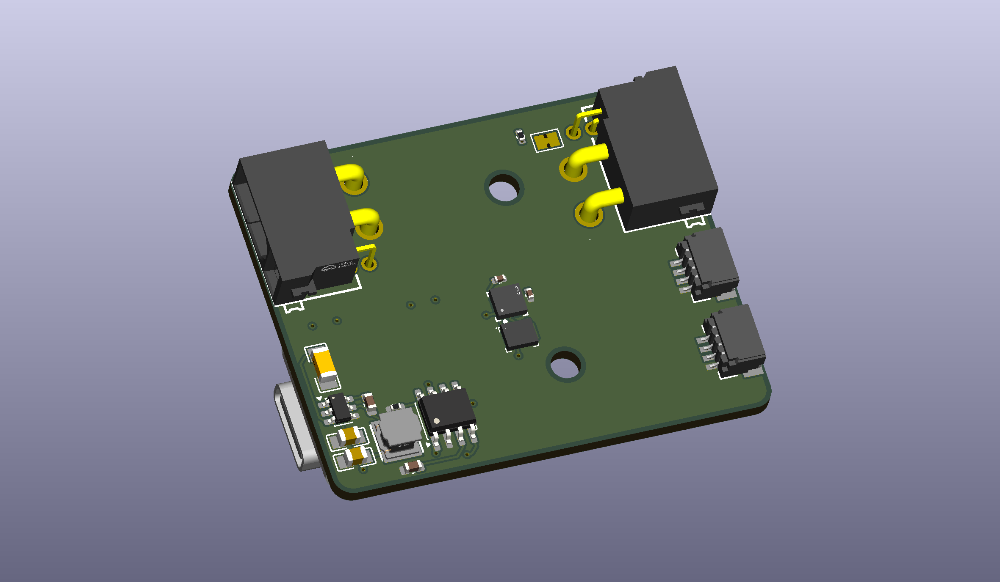
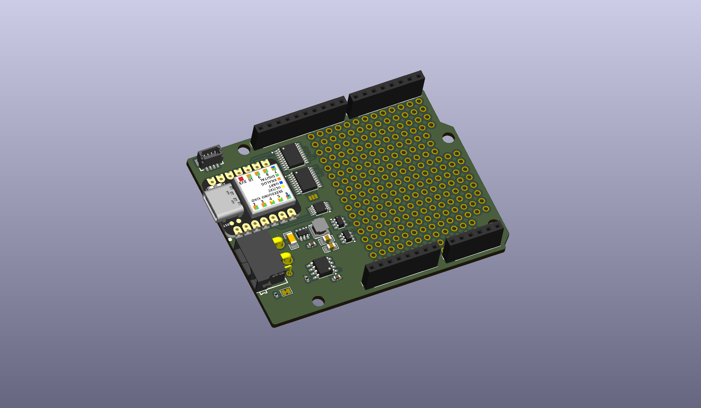
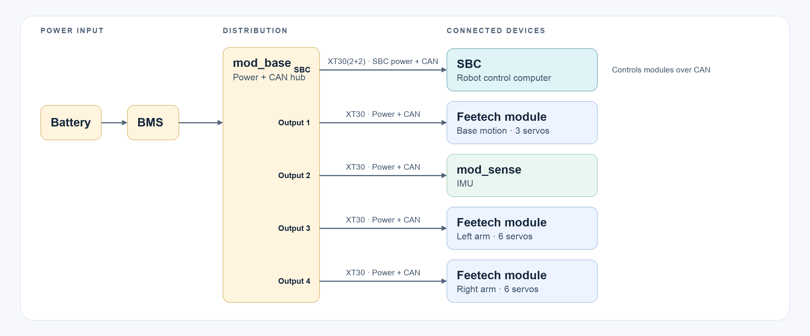
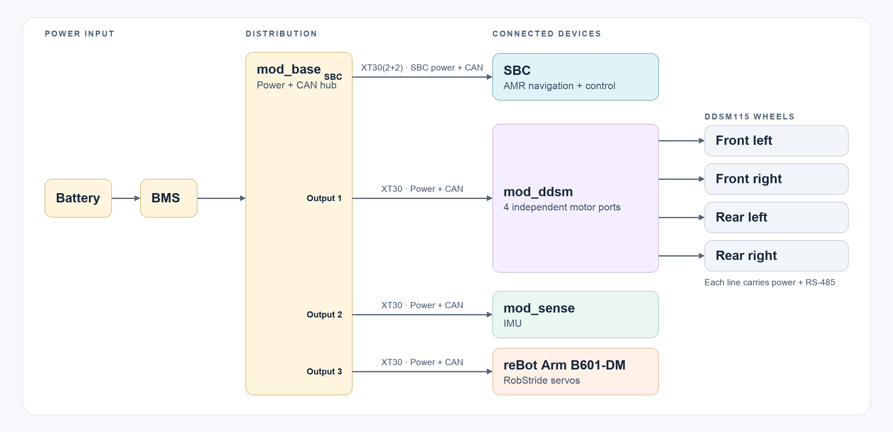

# Common Ground

Modular robot electronics built around a shared power and CAN backbone. Modules chain through XT30(2+2) connectors. Each module has a Seeed Studio XIAO RA4M1 for local control and is intended to communicate over a common CAN protocol.

## Shared architecture

- XT30(2+2) carries supply power, ground, CAN high, and CAN low.
- The XIAO RA4M1 and SN65HVD230 CAN transceiver provide local control and bus access.
- Boards include jumper-selectable 120 Ω CAN termination. Enable termination only at the two physical ends of a bus.

## Boards

| Board | Render | Role and hardware |
| --- | --- | --- |
| [mod_base](mod_base/) |  | - Battery input via XT60; charger/dock input via screw terminal - Individually fused XT30(2+2) power/CAN outputs - INA3221 monitors battery, dock, and load current - UART and RS-485 interfaces |
| [mod_ddsm](mod_ddsm/) |  | - Four hub motor power outputs - Four RS-485 and four UART connections, labelled FL/FR/BL/BR - SP3485, TMUX1308 receive multiplexer, INA226 current monitor, and MOSFET power cutoff - Two XT30(2+2) backbone connectors |
| [mod_feetech](mod_feetech/) |  | - Six three-pin Feetech servo connectors on a shared half-duplex data bus - 8 A servo supply regulator (TPS56A37) - Transmit/receive buffers, INA226 current monitor, and MOSFET power cutoff - Two XT30(2+2) backbone connectors |
| [mod_sense](mod_sense/) |  | - LSM6DSOX six-axis IMU and MMC5983MA magnetometer over I²C - Sensor interrupt signals - Two XT30(2+2) backbone connectors |
| [mod_kitchensink](mod_kitchensink/mod_kitchensink/) |  | - Arduino-style power, digital/PWM, and analog headers - Level shifters for compatibility with virtually every Arduino shield |
| [mod_raw](mod_raw/) | — | - Minimal starting point for custom modules - Shared XIAO/CAN/power circuitry, INA226 current monitor, and MOSFET power cutoff |

## Example: XLeRobot module chain

The diagram shows one possible XLeRobot layout. The SBC receives power and connects to the control network through its own XT30(2+2) connection to the base board, then controls the robot modules. The Feetech boards locally drive their attached servos.

The base board provides six fused outputs, so these four modules use four separate outputs and leave two available. Each branch carries the same CAN bus, so connect only the two bus endpoints with termination enabled.

## Example: AMR with DDSM115 drive and RobStride arm

This AMR layout uses one mod_ddsm for four independently connected DDSM115 wheel motors, with the reBot Arm B601-DM and an IMU on separate base-board branches. The SBC connects through XT30(2+2) for power and control. The arm uses RobStride servos. Check the arm's connection and power requirements against its documentation before wiring.

The base outputs are drawn as separate branches for clarity. They remain electrically connected to the same power source and CAN network; the output fuses isolate branch faults, not CAN traffic. Check motor and arm peak currents against the battery, BMS, wiring, and branch fuse ratings.

## Repository

Each board directory contains KiCad project, schematic, and PCB layout files. Available board renders are shown above and collected in [renders](renders/).

This README describes the current hardware designs. A common CAN protocol is an intended system feature; firmware and a protocol specification are not currently included here.
