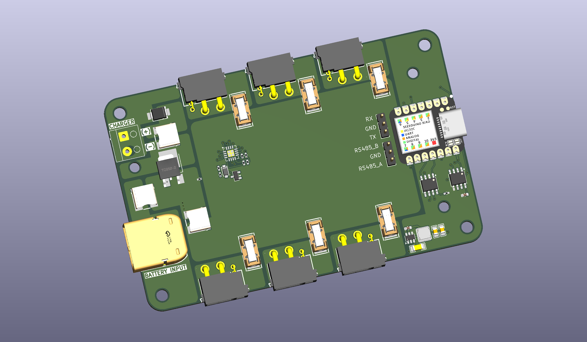
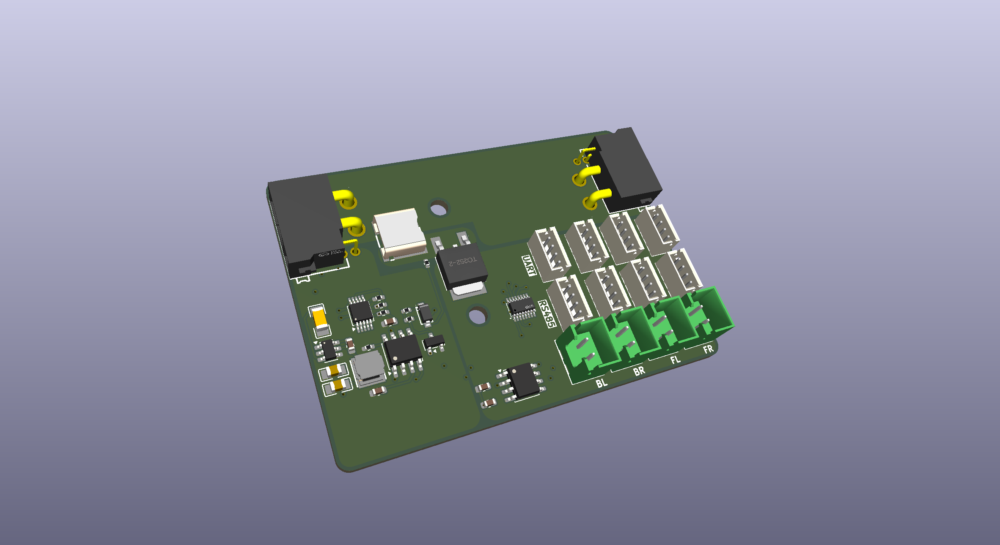
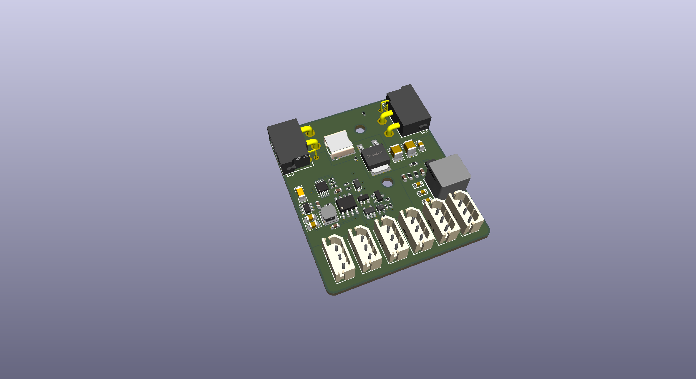

# Common Ground

Modular robot electronics built around a shared power and CAN backbone. Modules chain through XT30(2+2) connectors. Each module has a Seeed Studio XIAO RA4M1 for local control and is intended to communicate over a common CAN protocol.

## Shared architecture

- XT30(2+2) carries supply power, ground, CAN high, and CAN low.
- The XIAO RA4M1 and SN65HVD230 CAN transceiver provide local control and bus access.
- Boards include jumper-selectable 120 Ω CAN termination. Enable termination only at the two physical ends of a bus.

## Boards

| Board | Render | Role and hardware |
| --- | --- | --- |
| [mod_base](mod_base/) |  | - Battery input via XT60; charger/dock input via screw terminal - Six individually fused XT30(2+2) power/CAN outputs - INA3221 monitors battery, dock, and load current - UART and RS-485 interfaces |
| [mod_ddsm](mod_ddsm/) |  | - Four hub motor power outputs - Four RS-485 and four UART connections, labelled FL/FR/BL/BR - SP3485, TMUX1308 receive multiplexer, INA226 current monitor, and MOSFET power cutoff - Two XT30(2+2) backbone connectors |
| [mod_feetech](mod_feetech/) |  | - Six three-pin Feetech servo connectors on a shared half-duplex data bus - 8 A servo supply regulator (TPS56A37) - Transmit/receive buffers, INA226 current monitor, and MOSFET power cutoff - Two XT30(2+2) backbone connectors |
| [mod_sense](mod_sense/) | — | - LSM6DSOX six-axis IMU and MMC5983MA magnetometer over I²C - Sensor interrupt signals - Two XT30(2+2) backbone connectors |
| [mod_kitchensink](mod_kitchensink/mod_kitchensink/) | — | - Arduino-style power, digital/PWM, and analog headers - Level translation, ADS1015 ADC, and Qwiic-style I²C connector - One XT30(2+2) connector; currently an endpoint |
| [mod_raw](mod_raw/) | — | - Minimal starting point for custom modules - Shared XIAO/CAN/power circuitry, INA226 current monitor, and MOSFET power cutoff - Two XT30(2+2) backbone connectors |

## Example: XLeRobot module chain

The diagram illustrates one possible physical daisy chain from the base board's fused outputs. All modules share the same CAN bus; each Feetech board locally controls its attached servos. Servo loads draw from each board's regulated servo supply.

```mermaid
flowchart LR
    BAT[Battery] --> BMS[BMS] --> BASE[mod_base]
    BASE -->|XT30 power + CAN| FEET_BASE[Feetech<br/>Base motion<br/>3 servos]
    FEET_BASE -->|XT30 power + CAN| SENSE[mod_sense<br/>IMU]
    SENSE -->|XT30 power + CAN| FEET_LEFT[Feetech<br/>Left arm<br/>6 servos]
    FEET_LEFT -->|XT30 power + CAN| FEET_RIGHT[Feetech<br/>Right arm<br/>6 servos]

    classDef base fill:#f6bd60,stroke:#9a5b00,color:#202020,stroke-width:2px;
    classDef feetech fill:#90caf9,stroke:#1565c0,color:#102a43,stroke-width:2px;
    classDef sense fill:#a5d6a7,stroke:#2e7d32,color:#17351a,stroke-width:2px;
    class BAT,BMS base;
    class BASE base;
    class FEET_BASE,FEET_LEFT,FEET_RIGHT feetech;
    class SENSE sense;
```

The base board provides six fused outputs, so the four-module chain can occupy four outputs while leaving two available. In this example the base motion module and both arm modules use a Feetech board; confirm the intended servo count and current draw against the board's connector and regulator limits when building the robot.

## Repository

Each board directory contains KiCad project, schematic, and PCB layout files. Available board renders are shown above and collected in [renders](renders/).

This README describes the current hardware designs. A common CAN protocol is an intended system feature; firmware and a protocol specification are not currently included here.
